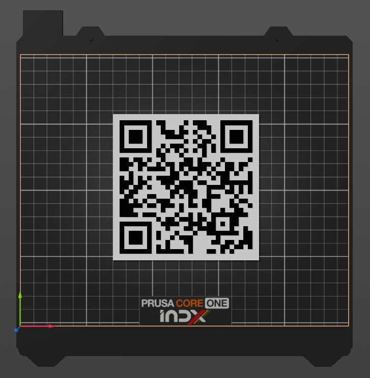

# QR Code Generator for PrusaSlicer

Create 3D-printable QR codes for text, links, and Wi-Fi directly in PrusaSlicer. Customize the QR pattern size, border on each side, base thickness, and height of the raised QR pattern.

PrusaSlicer added Lua plugins in **3.0.0-alpha11** and the in-app Plugin Marketplace in **3.0.0-alpha13**. See the [PrusaSlicer release notes](https://github.com/prusa3d/PrusaSlicer/releases/tag/version_3.0.0-alpha13#plugin-marketplace).

This QR code generator requires **PrusaSlicer 3.0.0-alpha13 or newer**.

## QR types

| Type | Status | What it’s for | Lua file |
| --- | --- | --- | --- |
| [Text or URL](docs/url.md) | Available now | Store a note, part number, asset ID, or link | `text_or_url.lua` |
| [Wi-Fi (WLAN)](docs/wifi.md) | Available now | Help guests join a Wi-Fi network | `wlan.lua` |
| vCard | Planned | Share contact details | `vcard.lua` |
| Location | Idea | Share a map pin | `geo.lua` |
| Email | Idea | Start an email with a recipient and optional subject | `email.lua` |
| Phone | Idea | Open the dialer with a number filled in | `phone.lua` |
| SMS | Idea | Start a text message to a number | `sms.lua` |
| Calendar event | Idea | Share event details someone can add to a calendar | `event.lua` |

## Pattern size and borders

**QR pattern size (mm)** sets the side length of the square QR pattern. Both commands default to an 80 mm pattern with 5 mm borders, producing a 90 × 90 mm plate.

In **Border**, enter one value in millimeters, such as `5`, for all sides. For different borders, enter four comma-separated values in **top, right, bottom, left** order. With the default pattern size, `5, 5, 25, 5` gives a 90 × 110 mm plate with extra room below the code. Use zero or positive values and a decimal point for fractions such as `2.5`.

If you add text or graphics, leave at least four QR modules of clear space on each side of the pattern.

## How it’s organized

Each QR command has a Lua file at the bundle root for its inputs and the data it encodes. The shared code lives in `lib/`. The commands use `lib/qr_plate.lua` to build the plate with `lib/qrencode.lua` for encoding, `lib/qr_geometry.lua` for the raised pattern, and `lib/utils.lua` for dimension checks.

## VS Code setup

Install the Lua extension by sumneko and extract the PrusaSlicer Lua API 1.0.0 stubs outside the plugin directory. Follow [Prusa’s editor setup guide](https://plugin-marketplace.prusa3d.com/docs/editor-setup) for the download.

Copy [`.luarc.json.example`](.luarc.json.example) to `.luarc.json` and replace the example path with the absolute path to the extracted stubs folder. Reopen the project in VS Code to enable PrusaSlicer API completion and hover documentation. Git ignores `.luarc.json`. Keep both editor files out of the signed plugin ZIP.

## Support the project

If you find it handy, give the repo a star. Got an idea for another QR type or found a bug? Open an issue. Pull requests are welcome, too.
