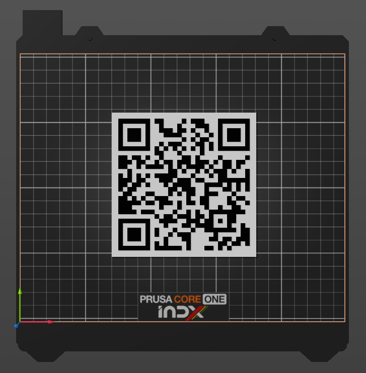

# QR Code Generator for PrusaSlicer

Create 3D-printable QR codes for text, links, Wi-Fi, and contacts directly in PrusaSlicer. Customize the QR pattern size, border on each side, base thickness, and height of the raised QR pattern, and add a keychain hole.

PrusaSlicer added Lua plugins in **3.0.0-alpha11** and the in-app Plugin Marketplace in **3.0.0-alpha13**. See the [PrusaSlicer release notes](https://github.com/prusa3d/PrusaSlicer/releases/tag/version_3.0.0-alpha13#plugin-marketplace).

This QR code generator requires **PrusaSlicer 3.0.0-alpha13 or newer**.

## QR types

| Type | Status | What it’s for | Lua file |
| --- | --- | --- | --- |
| [Text or URL](docs/url.md) | Available now | Store a note, part number, asset ID, or link | `text_or_url.lua` |
| [Wi-Fi (WLAN)](docs/wifi.md) | Available now | Help guests join a Wi-Fi network | `wlan.lua` |
| [vCard](docs/vcard.md) | Available now | Share contact details | `vcard.lua` |
| Location | Idea | Share a map pin | `geo.lua` |
| Email | Idea | Start an email with a recipient and optional subject | `email.lua` |
| Phone | Idea | Open the dialer with a number filled in | `phone.lua` |
| SMS | Idea | Start a text message to a number | `sms.lua` |
| Calendar event | Idea | Share event details someone can add to a calendar | `event.lua` |

## Pattern size and borders

**QR pattern size (mm)** sets the side length of the square QR pattern. All generators default to an 80 mm pattern.

**Border** sets the clear space around the pattern, called the quiet zone. Scanners need it to find the code. The default, `auto`, leaves four QR modules on every side, as the QR standard recommends. A module is one square in the QR grid, so an `auto` border grows with the module size. Enter a value in millimeters, such as `5`, to use the same border on every side.

For different borders, enter four comma-separated values in **top, right, bottom, left** order. Each value can be `auto` or millimeters. For example, `auto, auto, 25, auto` adds 25 mm below the code for a label. Use zero or positive values and a decimal point for fractions such as `2.5`.

Borders narrower than four modules can make the code harder to scan. If you add text or graphics, keep them outside the four-module margin.

### Model limits

The finished model can measure up to 1,000 mm along each axis, including the borders and both heights. The base and raised heights must each be at least 0.01 mm. Each QR module must be at least as wide as the smallest nozzle of the selected printer, or 0.01 mm if PrusaSlicer doesn’t report a nozzle. Denser codes need a larger pattern.

The border field accepts up to 256 bytes. The raised pattern can contain up to 900 model parts. Long content usually reaches this limit before the 1,024-byte limit for text and vCards. If that happens, shorten the content. Generate dense QR codes in an empty project because PrusaSlicer also counts parts from existing objects toward its scene limit.

Scanners guess the character encoding because the plugin doesn’t mark text as UTF-8. Most phones show accented letters such as ä, ö, ü, and ß correctly, but some older scanners don’t. Scan the print to check.

## Two-color prints

A QR code scans best with strong contrast between the raised squares and the plate. Use the **Two colors** dropdown in the dialog to print the squares in a second color:

- **Two colors: color change (one nozzle):** The plugin inserts an `M600` filament change before the first layer that contains only raised squares. It reads the layer heights from the print preset, so the change always lands on a real layer. The printer pauses, you swap the filament, and the rest of the squares print in the new color.

  **Preview shows only one layer in the new color.** Plugins can only insert custom G-code, so PrusaSlicer marks the change with a **G** on the layer slider but doesn't know the filament changed. It highlights only that layer and draws the layers above it in the base color. The print is still correct: nothing switches back, so every layer after the change prints in the new filament. The filament change also isn't included in the print time estimate.

  For a preview in two colors, choose **Two colors: off** and add PrusaSlicer’s own color change instead: in Preview, move the layer slider to the first layer above the base plate and click **+**. With a 2 mm base and 0.2 mm layers, that’s the 2.20 mm layer.

  The change applies to every object on that bed, so print QR codes on their own bed. Printers that don’t support `M600` need a different command.
- **Two colors: second tool (multi-tool):** The raised squares print with tool 2, and the plate prints with tool 1. This needs a printer with at least two tools, such as the Prusa CORE One INDX or XL. Load the colors you want in tools 1 and 2.

Dark squares on a light plate scan most reliably.

## Keychain hole

Set **Keychain hole diameter (mm), 0 = none** to a value above 0 to add a rounded tab with a hole for a key ring, centered above the plate. Leave it at `0` for no hole.

The tab is added outside the plate, so it never cuts into the QR pattern or the quiet zone, and the plate keeps its size. The finished model grows by the size of the tab: a 5 mm hole adds a tab 10 mm wide that sticks out 10 mm above the plate. The tab is as thick as the base plate and prints in the base color, also with **Two colors** turned on.

The diameter can be 1 to 30 mm. 5 mm fits most split rings and lanyard clips. The ring around the hole is 2.5 mm wide, or half the hole diameter for holes larger than 5 mm. The hole is a negative volume, so PrusaSlicer shows it as a separate part in the object list and cuts it when slicing.

## When a code can’t be created

If an input is invalid, for example a Wi-Fi password that’s too short, the plugin adds a thin plate to the bed with the reason embossed on it, starting with “QR code not created”. PrusaSlicer 3.0.0-alpha14 doesn’t show error messages from plugins, so this plate is how the plugin tells you what went wrong. Read the message, delete the plate, and run the command again with corrected values.

## How it’s organized

Each QR command has a Lua file at the bundle root for its inputs and the data it encodes. The shared code sits next to them in files that start with `lib_`. The bundle has no subfolders, because Marketplace installs of the earlier layout with a `lib/` folder failed. The commands use `lib_qr_plate.lua` to build the plate with `lib_qrencode.lua` for encoding, `lib_qr_geometry.lua` for the raised pattern, `lib_keychain.lua` for the optional keychain tab, and `lib_utils.lua` for dimension checks and layout. Each command runs through `lib_error_plate.lua`, which turns a failed check into an error plate on the bed. `lib_qrencode.lua` is vendored. [`VENDORED.md`](VENDORED.md) records its source and local changes.

The shared dimension params are copied into every command file because PrusaSlicer reads `info` before `require` is available. The **Check** workflow runs `scripts/check_shared_params.lua` to keep them identical and checks the syntax of every Lua file. The release workflow runs the same checks and stops if the release tag doesn’t match the `manifest.json` version.

## VS Code setup

Install the Lua extension by sumneko and extract the PrusaSlicer Lua API 1.0.0 stubs outside the plugin directory. Follow [Prusa’s editor setup guide](https://plugin-marketplace.prusa3d.com/docs/editor-setup) for the download.

Copy [`.luarc.json.example`](.luarc.json.example) to `.luarc.json` and replace the example path with the absolute path to the extracted stubs folder. Reopen the project in VS Code to enable PrusaSlicer API completion and hover documentation. Git ignores `.luarc.json`. Keep both editor files out of the signed plugin ZIP.

## Support the project

If you find it handy, give the repo a star. Got an idea for another QR type or found a bug? Open an issue. Pull requests are welcome, too.
